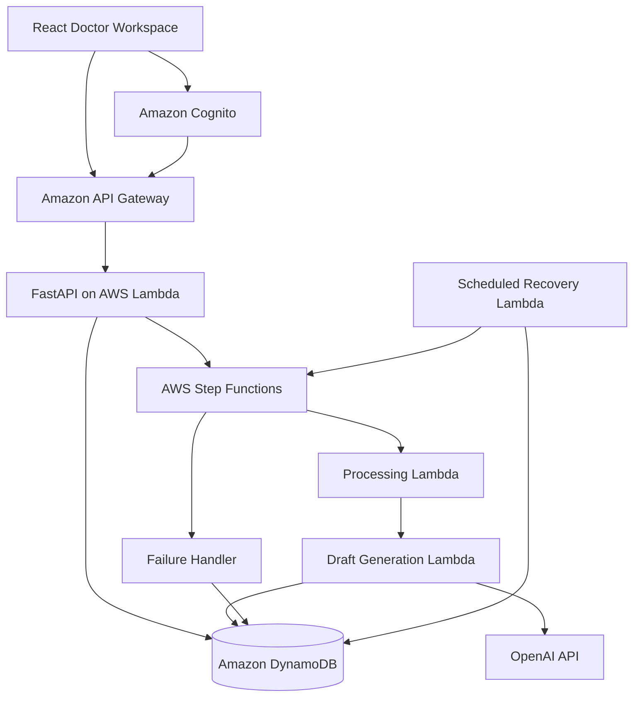

# MediFlow AI

### Serverless Healthcare AI Workflow Platform

MediFlow AI is a full-stack healthcare workflow prototype built with
React, FastAPI, AWS serverless services, and OpenAI.

It demonstrates how AI-generated clinical information can be integrated
into authenticated, asynchronous, reviewable workflows.

**Project status:** Functional development prototype using synthetic
patient records only.

## Key Features

- Public interactive demo with fictional patients and deterministic browser-only responses
- Cognito authentication for doctor accounts
- Patient-specific access controls
- Evidence-grounded clinical question answering
- Asynchronous discharge-letter generation
- Structured AI outputs with note references
- Explicit identification of missing clinical information
- Doctor editing, approval, and rejection workflows
- Idempotent job creation and concurrency protection
- Failure handling and scheduled job recovery
- CloudWatch monitoring and automated CI testing

## Architecture



## Discharge Letter Workflow

1. The doctor selects an authorized patient.
2. FastAPI creates an idempotent discharge job.
3. AWS Step Functions coordinates asynchronous processing.
4. The processing Lambda updates the job status.
5. The generation Lambda retrieves authorized clinical evidence.
6. OpenAI generates a structured, evidence-referenced draft.
7. The backend validates and persists the draft.
8. The doctor reviews, edits, approves, or rejects the document.

### Job Lifecycle

QUEUED → PROCESSING → PENDING_REVIEW → APPROVED / REJECTED

Failures can transition eligible jobs to FAILED.

All generated documents require explicit doctor review.
Review approval is not a digital or legal signature.

## Technology Stack

| Layer | Technologies |
|---|---|
| Frontend | React, TypeScript, Vite |
| Backend | Python, FastAPI, Pydantic, Mangum |
| Authentication | Amazon Cognito |
| API | Amazon API Gateway |
| Compute | AWS Lambda |
| Database | Amazon DynamoDB |
| Orchestration | AWS Step Functions |
| Generative AI | OpenAI API, Structured Outputs |
| Secret Management | AWS Secrets Manager |
| Monitoring | Amazon CloudWatch |
| Infrastructure | AWS SAM, CloudFormation |
| Testing & CI | pytest, Vitest, GitHub Actions |

## AI Safety and Validation

The prototype includes:

- Patient ownership checks before clinical data retrieval
- Structured output validation using Pydantic
- Validation of referenced clinical note IDs
- Explicit marking of undocumented sections
- Doctor confirmation before approval
- Version-controlled edits using DynamoDB conditional updates
- Unsigned document states

**Limitations:** Evidence-reference validation does not independently
establish clinical factual correctness.

The project is not a certified medical device, is not intended for
real patient use, and has not been validated for clinical deployment.

## Security

- Cognito JWT authentication protects clinical APIs.
- Backend services enforce doctor-patient ownership.
- OpenAI credentials are stored in AWS Secrets Manager.
- Clinical draft data is not persisted in browser application storage.
- DynamoDB conditional writes protect job transitions.
- CloudWatch monitors workflow and recovery failures.
- The project uses fictional patient records only.

Never upload real patient information, credentials, or protected health
information to this demonstration environment.

## Repository Structure

```text
mediflow-ai/
├── backend/
│   ├── app/
│   │   ├── ai/
│   │   ├── models/
│   │   ├── repositories/
│   │   ├── services/
│   │   └── workers/
│   └── tests/
├── frontend/
│   └── src/
│       ├── api/
│       ├── demo/
│       └── components/
├── infrastructure/
│   ├── discharge_worker/
│   └── template.yaml
├── scripts/
└── .github/
    └── workflows/
        └── ci.yml
```

## Local Development

### Frontend

Requires Node.js and npm. The public demo needs no AWS configuration:

```bash
cd frontend
npm ci
npm run dev
```

Open **http://localhost:5173/demo** directly. Refreshing resets all simulated
questions, edits, review decisions, and generation state.

For the authenticated Doctor Workspace at **http://localhost:5173/**, retain
the existing `.env.local` configuration, or copy `.env.example` and configure
your own Cognito and API Gateway values. The public demo does not require or
read that configuration.

See [Frontend README](frontend/README.md) for authentication and
configuration instructions.

### Backend Tests

```bash
cd backend
python3 -m venv .venv
source .venv/bin/activate
python -m pip install -r requirements.txt
python -m pytest tests/ -q
```

### Infrastructure Validation

Requires AWS SAM CLI.

```bash
cd infrastructure
sam validate --lint --region eu-south-1
```

Deployment requires a separately configured AWS account, credentials,
and infrastructure settings. Do not deploy the included development
configuration blindly into another environment.

## Continuous Integration

GitHub Actions automatically runs:

- Backend automated tests
- Frontend linting and tests
- Frontend TypeScript checks and production build
- AWS SAM template validation

These checks run for pull requests targeting `main` and pushes to `main`.

See [.github/workflows/ci.yml](.github/workflows/ci.yml).

## Demo

The existing authenticated application is hosted at
[mediflow.salehmmrezaei.com](https://mediflow.salehmmrezaei.com).

The unauthenticated landing page offers **Explore Interactive Demo** (`/demo`)
and **Doctor Sign In** (the existing Cognito hosted-login flow). The public
demo is an isolated frontend workspace for recruiters and portfolio visitors:

- Alice Example and Bob Example are fictional static records with invented notes.
- Selectable questions return prewritten answers and note references, including
  an insufficient-evidence example. No question is sent to OpenAI or another service.
- Discharge generation simulates `QUEUED → PROCESSING → PENDING_REVIEW`, with
  two documented sections and five missing sections. Visitors can edit documented
  sections, save in memory, confirm an unsigned approval with missing-information
  acknowledgement, or reject with a reason.
- Every screen displays **PUBLIC DEMO — SIMULATED DATA — NOT FOR CLINICAL USE**.
  No real Step Functions execution, DynamoDB write, or OpenAI request occurs.
- Demo state exists only in React memory. Reloading or starting a new demo session
  resets it; nothing is saved to localStorage, sessionStorage, analytics, or remote logs.

The `/demo` entry loads no Amplify authentication or production API clients.
The real Doctor Workspace retains Cognito session restoration and its existing
JWT-protected, AWS-backed patient, assistant, and discharge APIs. Returning home
or choosing **Doctor Sign In** leaves demo mode before the normal application loads.

### Verify the public demo

1. Run the frontend locally and open **http://localhost:5173/demo** in a private
   browser window, without signing in. Select each patient and each example question.
2. Generate a sample letter and observe all three generation states. Inspect seven
   sections and note IDs, edit and save a documented section, and try approval with
   and without missing-information acknowledgement. Generate a fresh sample to
   check rejection requires a reason.
3. Refresh `/demo` and confirm the initial state returns. In browser developer tools,
   confirm these interactions issue no backend or AI requests and store no demo data.
4. From `frontend`, run `npm run lint`, `npm test`, and `npm run build`. The tests include
   demo isolation and authenticated Doctor Workspace checks with the real API clients
   against mocked HTTP, without contacting AWS.

### Vercel routing

No deployment is performed by this change. After explicitly deploying this branch
through the existing Vercel project, open **https://mediflow.salehmmrezaei.com/demo**
(or the deployment's preview URL plus `/demo`) directly and refresh it. The existing
[`frontend/vercel.json`](frontend/vercel.json) catch-all rewrite serves `index.html`
for `/demo`, so both direct navigation and refresh reach the public entry.
Keep the project's existing Vercel environment variables and Cognito callback/logout
configuration unchanged. Verify **Return to Home** and **Doctor Sign In** separately;
the latter uses an existing doctor account and the existing hosted login.

## Future Improvements

- Patient-specific discharge-job history
- Stronger clinical evidence verification
- More comprehensive audit trails
- Operational dashboards and performance testing

## Source Code

GitHub: https://github.com/salehmmrezaei/mediflow-ai

## Disclaimer

MediFlow AI is an engineering demonstration for educational and
portfolio purposes. It must not be used to make clinical decisions or
process real patient information.
