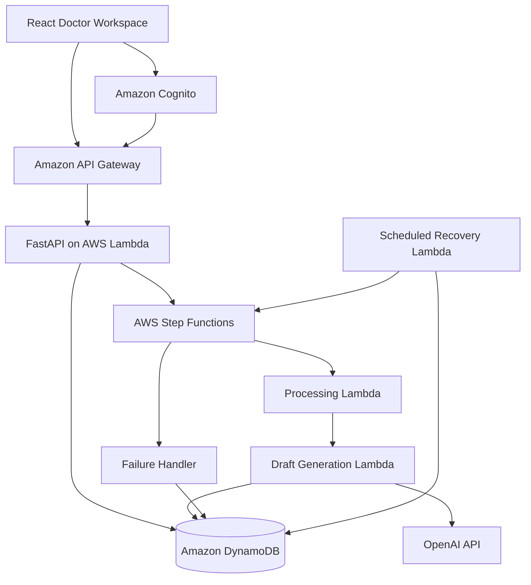

# MediFlow AI

### Serverless Healthcare AI Workflow Platform

MediFlow AI is a full-stack healthcare workflow prototype built with
React, FastAPI, AWS serverless services, and OpenAI.

It demonstrates how AI-generated clinical information can be integrated
into authenticated, asynchronous, reviewable workflows.

**Project status:** Functional development prototype using synthetic
patient records only.

## Key Features

- Cognito authentication for doctor accounts
- Patient-specific access controls
- Evidence-grounded clinical question answering
- Asynchronous discharge-letter generation
- Structured AI outputs with note references
- Explicit identification of missing clinical information
- Doctor editing, approval, and rejection workflows
- Idempotent job creation and concurrency protection
- Failure handling and scheduled job recovery
- CloudWatch monitoring and automated CI testing

## Architecture



## Discharge Letter Workflow

1. The doctor selects an authorized patient.
2. FastAPI creates an idempotent discharge job.
3. AWS Step Functions coordinates asynchronous processing.
4. The processing Lambda updates the job status.
5. The generation Lambda retrieves authorized clinical evidence.
6. OpenAI generates a structured, evidence-referenced draft.
7. The backend validates and persists the draft.
8. The doctor reviews, edits, approves, or rejects the document.

### Job Lifecycle

QUEUED → PROCESSING → PENDING_REVIEW → APPROVED / REJECTED

Failures can transition eligible jobs to FAILED.

All generated documents require explicit doctor review.
Review approval is not a digital or legal signature.

## Technology Stack

| Layer | Technologies |
|---|---|
| Frontend | React, TypeScript, Vite |
| Backend | Python, FastAPI, Pydantic, Mangum |
| Authentication | Amazon Cognito |
| API | Amazon API Gateway |
| Compute | AWS Lambda |
| Database | Amazon DynamoDB |
| Orchestration | AWS Step Functions |
| Generative AI | OpenAI API, Structured Outputs |
| Secret Management | AWS Secrets Manager |
| Monitoring | Amazon CloudWatch |
| Infrastructure | AWS SAM, CloudFormation |
| Testing & CI | pytest, Vitest, GitHub Actions |

## AI Safety and Validation

The prototype includes:

- Patient ownership checks before clinical data retrieval
- Structured output validation using Pydantic
- Validation of referenced clinical note IDs
- Explicit marking of undocumented sections
- Doctor confirmation before approval
- Version-controlled edits using DynamoDB conditional updates
- Unsigned document states

**Limitations:** Evidence-reference validation does not independently
establish clinical factual correctness.

The project is not a certified medical device, is not intended for
real patient use, and has not been validated for clinical deployment.

## Security

- Cognito JWT authentication protects clinical APIs.
- Backend services enforce doctor-patient ownership.
- OpenAI credentials are stored in AWS Secrets Manager.
- Clinical draft data is not persisted in browser application storage.
- DynamoDB conditional writes protect job transitions.
- CloudWatch monitors workflow and recovery failures.
- The project uses fictional patient records only.

Never upload real patient information, credentials, or protected health
information to this demonstration environment.

## Repository Structure

```text
mediflow-ai/
├── backend/
│   ├── app/
│   │   ├── ai/
│   │   ├── models/
│   │   ├── repositories/
│   │   ├── services/
│   │   └── workers/
│   └── tests/
├── frontend/
│   └── src/
│       ├── api/
│       └── components/
├── infrastructure/
│   ├── discharge_worker/
│   └── template.yaml
├── scripts/
└── .github/
    └── workflows/
        └── ci.yml
```

## Local Development

### Frontend

Requires Node.js and npm.

```bash
cd frontend
npm ci
cp .env.example .env.local
npm run dev
```

Configure `.env.local` using your own Cognito and API Gateway values.

See [Frontend README](frontend/README.md) for authentication and
configuration instructions.

### Backend Tests

```bash
cd backend
python3 -m venv .venv
source .venv/bin/activate
python -m pip install -r requirements.txt
python -m pytest tests/ -q
```

### Infrastructure Validation

Requires AWS SAM CLI.

```bash
cd infrastructure
sam validate --lint --region eu-south-1
```

Deployment requires a separately configured AWS account, credentials,
and infrastructure settings. Do not deploy the included development
configuration blindly into another environment.

## Continuous Integration

GitHub Actions automatically runs:

- Backend automated tests
- Frontend linting and tests
- Frontend TypeScript checks and production build
- AWS SAM template validation

These checks run for pull requests targeting `main` and pushes to `main`.

See [.github/workflows/ci.yml](.github/workflows/ci.yml).

## Demo

A controlled online demonstration is planned.

The public demonstration will use fictional clinical records and
restricted access. It will not expose development doctor credentials.

## Future Improvements

- Controlled hosted demo with spending limits
- Patient-specific discharge-job history
- Stronger clinical evidence verification
- More comprehensive audit trails
- Operational dashboards and performance testing

## Source Code

GitHub: https://github.com/salehmmrezaei/mediflow-ai

## Disclaimer

MediFlow AI is an engineering demonstration for educational and
portfolio purposes. It must not be used to make clinical decisions or
process real patient information.
